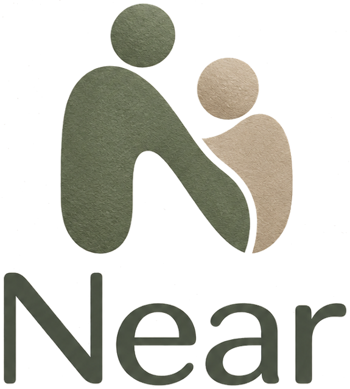

# Near



A calm companion for people living with Alzheimer's disease, and for the relatives who help them.

Near was first called Dezheimer: the repository, the folders on the computer (`%USERPROFILE%\.dezheimer`) and the code still use that name, so that nothing already saved is lost.

**Look and feel.** Warm, simple and reassuring, for older eyes and hands: the cream of old paper, the sage green and warm beige of the logo, large text in Atkinson Hyperlegible Next (a font made by the Braille Institute for readers with low vision, kept in the app), rounded shapes, generous space, simple line icons. Never clinical, childish or busy.

Near listens to daily life, writes down what happened, and turns it into three things the person can come back to at any time: an agenda, a memo for each family member and friend, and a personal diary. The goal is to make everyday life and social relationships easier when memory is no longer reliable.

> **Status:** first version of the whole chain, on example data: a voice assistant that adds events, people, connections and memos and answers questions aloud; spoken reminders; a connections map; and a language model that proposes diary summaries and memos from a recorded conversation. The assistant has been used by voice on a computer and on an iPhone, by the developer only; misheard words are its main weakness. The language model still misses about half of the news. See [CHECKPOINT.md](CHECKPOINT.md) for where we are and [GUIDELINE.md](GUIDELINE.md) for the full plan.

## Try it

Double-click [start.bat](start.bat). It needs Python 3.12 and Windows. The language model needs an NVIDIA graphics card with 8 GB of memory.

- The first start installs the dependencies and downloads the speech model. This takes a few minutes.
- The app then opens in the browser at http://localhost:8765.
- To stop it, close the black window.

### Talk to the app

The home screen starts with one large button. Tap it and say one thing, in English:

- "What do I have today?" or "When do I see Sarah?"
- "Who is Rose?" or "How do I know Paul?"
- "I plan to go to the market tomorrow at 10."
- "Move the lunch with Sarah to 1 pm." or "Cancel my appointment with the doctor."
- "Add a new person, her name is Julie, she is my niece."
- "Julie is Sarah's daughter."
- "Remember that Emma won her competition." or "Memo about Emma: she won her competition."
- "Elinor is my sister." (about someone already in your people)
- "Give me some information about Nadia."
- "Search for the radiator."

The app answers aloud, with an English voice of the device. If the device has none (a Windows computer set up in French, for example), it says so on the home screen: the app would otherwise speak English with a French voice. To add one on Windows: Settings, Time and language, Speech, Add voices, English. Chrome brings its own English voices. Before it writes anything down, it reads it back and waits for "yes" or "no". It also reminds you aloud of each event 30 minutes before, 5 minutes before, and when it starts, as long as the app is open.

To add an event, the app needs a day, a time, a place and who it is with, and asks for whatever is missing. Answer "alone" or "nowhere" when there is nobody or no place.

If a name is not heard exactly, the app asks: "Do you mean Rose?" Before you say yes, you can also correct by hand what the app is about to write: the name of a new person, the title and place of an event, the text of a memo.

### The simple things of the day

**To do today.** The home screen has a block with the pills, the meals, and whatever else comes back every day or on some days of the week. Touch **Done** when a thing is done, or say it: "I took my pills." You can then ask at any time: "Did I take my pills?", "Have I had dinner?", "What do I still have to do?" The app answers with the time it was done. A thing that has a time and is not done is said aloud at that time, and once more half an hour later, while the app is open. To add one by voice: "Every day at 10, water the plants." or "Every Tuesday at 8, take out the bins."

**Never from memory.** "Did I take my pills?" is answered from what was noted, never from what the person remembers. With no note, the app does not say "take them": it sends the person to the pill box ("Look at your pill box, at Friday morning. If the pills are still in it, take them now. If it is empty, you have already taken them."), and "The box is empty" notes them as taken. Once noted: "You do not need to take them again." With no note of a meal: "It is a good time to eat something." The app recognizes the pills, the meals, a drink and washing from the words of each thing.

**Reminders when the app is closed.** Signed in, open **My day** and press **Remind me even when it is closed** (on an iPhone, from the icon on the home screen). The server then sends a notification at the time of each thing not done, and once more half an hour later. Touching it opens one big screen: **I took them** or **It is done**, and for the pills, the box to take them from. Pills more than an hour before their time are marked "It is not time yet". While the app is open, it reminds aloud by itself, with a **Done** button, and no notification is sent.

**The relatives are told.** When the pills are not noted 45 minutes after their time, or a meal or a drink 2 hours after, the linked relatives get a notification ("Helen has not noted: Take the morning pills. Ask Helen to look at the pill box, at Friday morning..."). In their app they see the day of the person: what is done and when, what is not yet, and what is late.

**Step by step.** For something with steps, such as a recipe, the app keeps your place. Say "I want to make an omelette", or open **Step by step** and choose. The app says what you need and the first step. Then:

- "Done." or the button **Done, next step**: the next step is read aloud.
- "What is next?" and "Where am I?": the step to do now, and what is already done.
- "Did I put the salt?": yes, not yet, or at which step it comes.
- "I added the salt.": noted, and the next step is read. If steps before it are not done, the app says which.
- "Stop the recipe."

The place is kept if the app is closed, for six hours. Two examples are there, a cup of tea and an omelette; add your own under **Change my lists**: a name, what is needed, and the steps, one on each line.

**My day** (opened from the block on the home screen) also has:

- **Before I leave home**: keys, phone, card. Touch each one when you have it; the app says when you have everything. You can also say "I am leaving."
- **Good to know**: things that do not change, such as the code of the building or where the keys are. Add them there, or say "Remember that the keys are in the blue bowl", then ask "Where are my keys?"
- **The last seven days**: what was done each day, for you and for whoever helps you.

Under **Change my lists** you add and remove things. With your own data the lists start empty; **Start with the usual ones** puts the pills, the three meals, keys, phone and card, and the two examples of steps. Do not write a secret code there yet: the backup is not encrypted.

### Take me there

An event whose place was found on the map has a **Take me there** button, in the agenda and on the home screen, and in its reminder. The app finds the walking way from where you are and shows it on its own map, with the next turn written large and said aloud when it is close. The time on foot is counted for a slow walk.

While the app is open, it watches the way. When you are off the way for 30 seconds, or when you press **I am lost**, it says calmly where you are going, the time of the event and the street you are on, finds the way again from where you are, and shows it. When you arrive, it says so. The walk is kept if the app is closed, for six hours.

Keep Near open on the screen during the walk: a web app only gets the position while it is showing, so nothing is watched when the phone is locked or when Google Maps is in front (**Open in Google Maps** is there for whoever prefers it). The screen is kept on. Places further than 5 km are not walked to: the app says to ask someone to drive, or to take a taxi. The way is found by an open routing service built on OpenStreetMap (routing.openstreetmap.de), to which the position of the start and of the place are sent.

### For a relative

The first time the app opens, it asks who uses the phone: **Me** (the person who wants help with their memory) or **A relative** (someone who helps them). A relative's app is a small, separate app: the people they help.

To link a relative, both need an account (**Account** at the bottom of the screen). On the person's phone, open **Account** and press **Link a relative**: a code of 6 digits appears, valid for 30 minutes. On the relative's phone, type it under **Link with someone**, with the name the person knows them by. A link says who is told when the person gets lost. Either side can remove it. The choice of who uses the phone can be changed under **Account**.

**Alerts.** When the person is lost a second time on the same walk (see "Take me there"), and each time after, the app tells the linked relatives: where the person is, the street, and where they were going. The person hears "I have told Sarah where you are." The relative's app shows the latest alert of the day for each person, with **See where on the map**, and looks for new ones every 30 seconds while it is open. To be told when the app is closed, press **Turn on notifications** on the relative's phone. On an iPhone this only works from the icon on the home screen (Safari, Share, "Add to Home Screen", iOS 16.4 or later), not in Safari itself.

The notification goes from the computer that runs Near to the push service of the phone's maker (Apple or Google), encrypted so that this service cannot read it. The relative's phone must reach that computer once, to be linked and to switch notifications on: on the same Wi-Fi, or through Tailscale (`start-anywhere.bat`), where the owner of the computer shares it with the relative's own Tailscale account (in the Tailscale admin console, **Share** on the computer).

### Use it on an iPhone

The iPhone is the screen, the microphone and the loudspeaker; the models still run on the computer. Both must be on the same Wi-Fi, so this works at home only.

1. On the computer, close the Near window if one is open, then double-click `start-phone.bat`. If Windows asks whether Python may be reached from the network, allow it for private networks.
2. The window shows two addresses, their QR codes and a 6-digit code, and the computer opens a page with the same QR codes. Point the iPhone camera at the first one (or type the address that starts with `http://` in Safari) and follow the steps of the page: download the certificate, install it, trust it. This is done once.
3. Open the second address (it starts with `https://`, or scan the second QR code), type the code, and allow the microphone and the position.
4. In Safari, tap Share, then "Add to Home Screen". Near then opens like an app.

The certificate is made by your computer and only lets the iPhone trust that computer. The code is there because anyone on the same Wi-Fi can reach the address.

### Use it on your phone anywhere

The models still run on the computer, which must stay switched on, plugged in and connected to the internet. The phone reaches it through [Tailscale](https://tailscale.com), a private network between your own devices: the traffic is encrypted from the phone to the computer, and only devices signed in to your Tailscale account can open the address. Nothing is made public.

Once:

1. On the computer, install Tailscale from https://tailscale.com/download and sign in (a free personal account is enough).
2. On the phone, install the Tailscale app, sign in with the same account, and switch it on.

Then:

1. On the computer, close the Near window if one is open, and double-click `start-anywhere.bat`. The first time, Tailscale may give a link to allow secure addresses (HTTPS) for your devices: open it, allow, and start again.
2. The window shows an address that starts with `https://`, and its QR code. Point the phone camera at it, or type it in Safari, and allow the microphone and the position. There is no certificate to install and no code.
3. In Safari, tap Share, then "Add to Home Screen".

While the window is open, Windows does not go to sleep by itself. Closing the lid of a laptop still puts it to sleep, unless you change that in the Windows power settings.

What you add is kept in the browser of the phone. To also keep it on the computer, open **Account, backup and my own data** and create an account.

### Use it for yourself

The app opens on an example: Helen, her family and her week. To use it with your own life, open **Account, backup and my own data** at the bottom of the home screen, type your first name and press **Start with my own data**. The app is then empty and holds only what you add; it calls you by your name. The example stays available from the same screen, and going back to it does not delete your data.

### Places on the map

When you add an event, the app looks for its place on the map around you, and reads back what it found with the address and the distance. If several places have the same name, tap the right one, or "None of these". The first time, the browser asks for permission to use your position; if it cannot give it, the app asks in which town you are. This search needs the internet: the name of the place and a rough position are sent to an open map service.

### Improvement mode

After each request, the app asks "Did I do what you wanted?". Press **Yes, it did what I wanted**, or **No** and write what you wanted. Every exchange is saved as soon as it ends, with your answer when you give one, in `%USERPROFILE%\.dezheimer\feedback\feedback.jsonl`, outside the project folder, and is used to improve the app. If the phone cannot reach the computer at that moment, the exchange waits on the phone and is sent when it can. The mode can be switched off under "What can I say?".

### Teach the app your voice

The goal is a speech model small enough to run inside the phone. A small model hears a new voice badly until it is trained on it, and training needs recordings of you with the exact words that were said. There are two ways to make them, and both end in the same place.

**Read a text aloud, ten minutes in all.** At the bottom of the home screen, open **Teach the app my voice**, on the phone or on the computer. There are three texts of about three minutes each. They are made of the things you say to the app (questions, appointments, people, short answers) and of many Israeli first names and places: Elinor, Lothan, Ilan, Saba, Givatayim, Ramat Gan, Park Leumi, Petah Tikva... Choose a text, press **Start reading**, read it from start to end at your usual pace, and press **I have finished**. If you make a mistake, just go on. The sound is sent to the computer while you read, and kept there with the text. A text can be read again: another day, another room and another mood all help.

**Just use the app.** With **Keep the sound of my voice** switched on (under "What can I say?"), everything you say to the assistant is kept too. Nobody has checked those words, so a much larger speech model writes them down afterwards, on the computer.

Then double-click `dataset.bat` on the computer. A large speech model (the first run downloads it, about 1.6 GB) does two things. It cuts each reading where you paused, into pieces of 5 to 18 seconds, and finds which words of the text were read in each piece: the piece is kept with the words of the text, so the names are spelled right even where the model misheard them, and a piece where you said something else is left out. It also writes down what you said to the assistant. It then makes two files in `%USERPROFILE%\.dezheimer\dataset`: `train.jsonl` to train the small model on, and `test.jsonl` to measure it with. The test file only holds phrases a person is sure of, and is never trained on.

### Measure how well the app hears you

Under "What can I say?", switch on **Keep the sound of my voice**. It is off by default. Each request you then say to the assistant is kept as a sound file in `%USERPROFILE%\.dezheimer\recordings`, on the computer that runs Near, with what the app heard. The Listen tab never keeps any sound.

After some practice, double-click `measure.bat`. It plays each new phrase and shows what was heard: press Enter if it is right, or type what you really said (`d` deletes the recording). It then compares the sizes of the speech model on your phrases: the share of words heard wrong, and the share of your own names and places written right, with and without your vocabulary. About 100 phrases give a fair comparison. The first run downloads the models it does not have yet.

### Keep a backup

At the bottom of the home screen, open **Account and backup** and create an account with an email and a password. What you add is then saved in your account after each change, and loaded when you sign in on another device. For now the server runs on this computer only, so "another device" means another browser on this computer until the server is put online.

### Record a conversation

Open the **Listen** tab, switch on the microphone, allow the browser to use it, and speak in English. The audio of this tab stays on the computer and is never saved.

To add an event by voice, say a sentence that contains "in my agenda", for example:

> Add to my agenda a coffee with Sarah tomorrow at 3 pm at Carmel coffee.

The app shows what it understood (what, when, where, with whom). Click **Add to the agenda** to accept it. If the day or the time is missing, say it in the next few seconds.

To keep what was said in a conversation, click **Find what to remember** at the bottom of the Listen tab. A small language model reads the text and proposes a summary for the diary and memos about people and things. Each proposal shows the words it comes from, and nothing is kept until you accept it. This takes 15 to 40 seconds.

### See how people are connected

The **People** tab has a map of how everyone is connected. Touch a person to see how you know them and who they are linked to, or use the search box to find a person from any word about them.

The other tabs show a fictional user, Helen, with her family, friends, agenda and diary. The example data is dated relative to the current day, so it always shows a live week. It lives in [web/js/data.js](web/js/data.js). These tabs also work without the server, by opening [web/index.html](web/index.html) directly.

## Project layout

| Folder | Content |
| --- | --- |
| [web/](web/) | The app: HTML, CSS and JavaScript, no build step. |
| [server/](server/) | The Python server: serves the app, transcribes the microphone audio with Whisper (`openai/whisper-small.en`), understands voice requests with a small sentence model (`sentence-transformers/all-MiniLM-L6-v2`) and rules, and finds summaries and memos with a small language model (`Qwen/Qwen2.5-3B-Instruct`). All models come from Hugging Face and run locally. |
| [tests/](tests/) | Tests of the voice requests. Run them with `python -m unittest discover tests`. |

## What it does

| Feature | What the person gets |
| --- | --- |
| **Agenda** | Appointments and meetings, with reminders, created and updated automatically from conversations. |
| **People memos** | One page per family member or friend: who they are, their photo, what is going on in their life, and what was said last time. Useful to read before a visit or a call. |
| **Diary** | A short daily entry describing what happened that day, written automatically. |

## How it works

```
Conversation ──► Transcription model ──► Transcript ──► Summarization model ──┬──► Agenda events
  (audio)          (small, local)          (text)       (extracts what matters) ├──► People memo updates
                                                                                └──► Diary entry
```

1. A small speech-to-text model writes down conversations.
2. A second model reads the transcript, keeps the important information, and proposes updates to the agenda, the memos and the diary.
3. The web app displays everything in an interface designed for people with memory loss.

## Roadmap

1. **Web prototype** — a website with example data, to visualize the product.
2. **Transcription** — a small model that writes down discussions.
3. **Summarization** — a model that extracts the important information, creates memos and updates the agenda.
4. **Integration** — connect the two models to the app, end to end.
5. **Reminders, caregiver access and user testing.**

Each step is detailed in [GUIDELINE.md](GUIDELINE.md).

## Documents

- [GUIDELINE.md](GUIDELINE.md) — vision, principles, and the step-by-step plan.
- [CHECKPOINT.md](CHECKPOINT.md) — current state of the project, updated at each milestone.
- [NEEDS.md](NEEDS.md) — the needs of a person with Alzheimer's, from the most disabling to the least, and the constraints of use.

## Disclaimer

Near is a daily-life aid. It is not a medical device and does not diagnose, treat or monitor the disease.
